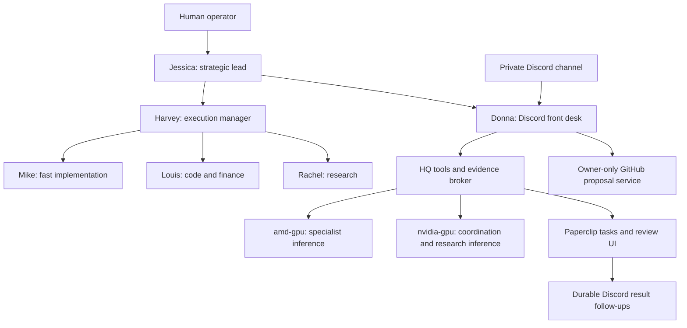

# LLM Setup — KrishAdmin HQ

A Discord front desk, the **Suits specialist team**, local GPU inference, Paperclip task tracking, fixed host diagnostics, an encrypted OpenBao credential vault, and owner-only GitHub code proposals.

This is the **public source/configuration edition**, captured on 2026-11-14. It uses generic GPU aliases, documentation-only network addresses and example identity values. Configure your own environment before running it. Credentials, conversations, uploads, databases, backups and mutable application state are deliberately excluded. This is a source recovery reference, not a complete application-data backup.

## Start here

| Guide | What it covers |
|---|---|
| [Benjamin and secure credentials](deployments/hermes/docs/benjamin-server-operations.md) | Server ownership, private enrollment and connector access |
| [Full runbook index](deployments/hermes/docs/index.md) | Architecture, operations, monitoring, recovery and acceptance |
| [Discord prompt guide](deployments/hermes/docs/discord.md) | Copyable prompts, compute routing, permissions and automatic task updates |
| [Suits team](deployments/hermes/docs/capabilities.md) | Models, hierarchy, delegated workflows and uploaded-file support |
| [Internet, MCP and long-context work](deployments/hermes/docs/mcp.md) | Public search, weather, fixed workbench workflows, files and larger model windows |
| [Owner-only GitHub](deployments/hermes/docs/github.md) | Read code, prepare a diff and publish an owner-confirmed review branch |
| [Host diagnostics](deployments/hermes/docs/diagnostics.md) | Fixed GPU, CPU/process, service and storage checks |
| [Deployment and recovery checklist](DEPLOYMENT.md) | Dependencies, configuration, secrets and restoration order |
| [Included components](COMPONENTS.md) | What is included and what remains local |
| [Verification](VERIFICATION.md) | Checks actually performed and their limits |

## The Suits team

| Character | Role | Model | Backend |
|---|---|---|---|
| **Jessica Pearson** | Strategic lead; major architecture decisions | Mixtral 8x22B, 140.6B MoE | amd-gpu |
| **Harvey Specter** | Execution manager; practical plans | Gemma 27B | amd-gpu |
| **Louis Litt** | Code, configuration and financial analysis | Qwen2.5 Coder 32B | amd-gpu |
| **Mike Ross** | Fast generalist; optional deep-analysis escalation | Qwen3.5 9B; Qwen2.5 72B when escalated | nvidia-gpu; amd-gpu escalation |
| **Rachel Zane** | Source research and citations | Qwen3.5 9B | nvidia-gpu |
| **Donna Paulsen** | Chief of staff and Discord coordinator | Qwen3.5 9B | nvidia-gpu |
| **Benjamin** | Server operations and workspace implementation; reports to Harvey | Qwen3.5 9B through the Pi runtime | nvidia-gpu |

Jessica leads the team. Harvey and Donna report to Jessica; Mike, Louis and Rachel report to Harvey. Human approval remains required for production changes. These are configured specialist services and model assignments, not merely names inserted into chat responses.



## What works

- Enrolled Discord users can use mentions in the main channel or personal DMs; GitHub remains owner-only in the main channel or verified owner DM.
- Actual specialist inference receipts identifying backend, model, timing and GPU residency.
- Public web search, direct page reading and current weather through local MCP tools; ordinary research synthesis uses amd-gpu.
- Jessica → HQ web collection → Rachel research with fetched-source citations.
- Jessica 64K context, 32K general/coder analysis, and automatic conversation compaction on amd-gpu.
- Repeatable checker, file-review and automation-design workflows with actual execution receipts.
- Supported uploaded documents and code, bounded reads, syntax checks and draft files.
- Paperclip tasks, Suits team UI, review cards, evidence attachments and correct task URLs.
- Automatic Discord task-result follow-ups with retry/reconciliation and edit-in-place updates.
- Fixed local/SSH diagnostics; short CPU samples are distinguished from GPU inference evidence.
- GitHub repository reads, bounded code-change previews and owner-confirmed new review branches. No main-branch overwrite, force-push, merge or execution of repository code.
- Supporting n8n workflows, gateway/proxy configuration, monitoring, backup tooling and UI theme sources.

Research, GitHub access, file parsing and orchestration happen on HQ. The amd-gpu inference workflow receives evidence and does not browse. The fixed host checker is a separate, explicitly bounded diagnostic path.

## Repository layout

```text
LLM-Setup/
├── README.md
├── DEPLOYMENT.md
├── COMPONENTS.md
├── VERIFICATION.md
├── SOURCE-MANIFEST.json
├── deployments/
│   ├── hermes/             # Broker, specialists, Discord plugin, skills, runbooks, tests
│   ├── paperclip/          # Agent adapters, review UI, host probes, worker isolation
│   ├── n8n/                # Workflows, Compose, backup helpers, portal
│   ├── ai-gateway/         # Existing inference proxy/service configuration
│   ├── ai-local/           # Existing local research worker
│   └── openwebui-gateway/  # Gateway and custom theme assets
├── docs/                   # Supporting operational notes
├── config/                 # Non-secret configuration references
├── scripts/                # Network, GPU setup and maintenance tools
└── tests/                  # Supporting test fixtures
```

See [THIRD-PARTY.md](THIRD-PARTY.md) for upstream projects. Existing repository content outside `LLM-Setup/` is preserved.

Public research now checks whether sources answer the question, makes follow-up searches, extracts embedded channel/structured metadata, and supports an isolated read-only browser for JavaScript pages. See the [research and MCP runbook](deployments/hermes/docs/mcp.md#8-research-depth-and-dynamic-pages).

## November 9 stack update

The latest sources include GPU container recovery and early residency checks, measured status/temperature replies, queued Suits workers, source-reviewed research, and bounded project tracking for the two HQ repositories. Paperclip replies end with report links. Ordinary long Discord replies use a full Markdown attachment after three formatted chunks or 6,000 conservative text units; shorter replies split normally.

Per-user Gmail/Calendar code is included, with private DM access and separate confirmation for sends/event changes. **Individual OAuth is still required**; no live Google account is connected by this export. See [Google setup](deployments/hermes/docs/workspace.md).

[Herdr.dev integration guidance](deployments/hermes/docs/herdr.md) uses terminal panes on HQ with the existing broker and Suits services. Herdr itself has not been installed or validated on the host. See [the repair record](deployments/hermes/docs/repair-2026-11-09.md) and [Discord delivery behavior](deployments/hermes/docs/discord.md) for evidence and remaining limits.

## Context controls and live dashboard

[Every local runtime's context window](deployments/hermes/docs/contexts.md) is documented, with a validated HQ CLI for previewing, applying and rolling back changes. The Discord bot reads actual context settings instead of guessing model limits. Default allocations were retained after control tests.

[Control Center](deployments/hermes/docs/dashboard.md) includes the entire registered agent inventory and a live GPU view with per-card utilization, VRAM, power and temperatures. GPU telemetry refreshes separately from the five-minute integration inventory. Unknown, stale and incomplete readings stay explicit.

## November 14 additions

Benjamin now receives server-operations tasks directly and uses fixed host/Pi/monitoring connectors. The vault offers hidden-input enrollment with service metadata and a non-secret catalog. The source includes Paperclip execution/blocker repairs and the repaired job-manager prototype under `examples/job-manager`; that prototype is partial, with no full web UI or production scheduler.

This is a configurable reference deployment, not a turnkey product. Start with [deployment prerequisites](DEPLOYMENT.md). Passwords, tokens, unlock credentials, vault snapshots and runtime state are not part of either repository edition.

## Central agent Hub

[KrishAdmin-LLM-Hub](deployments/hermes/docs/llm-hub.md) gives all seven Suits members their own inbox, workspace, deliverables, archive and skills folders. Existing agent profiles, shared skills, uploads and runtime files are relocated with compatibility links. Owner-only file review saves specialist reports; Benjamin's tracked artifacts are mirrored into his deliverables. Each agent can run requested Python checks in a disposable container with only its own workspace mounted and no network or credentials. Daily private file snapshots validate extraction.

The Hub's private files and backups are not included in this repository; the implementation, migration helpers and runbooks are.
