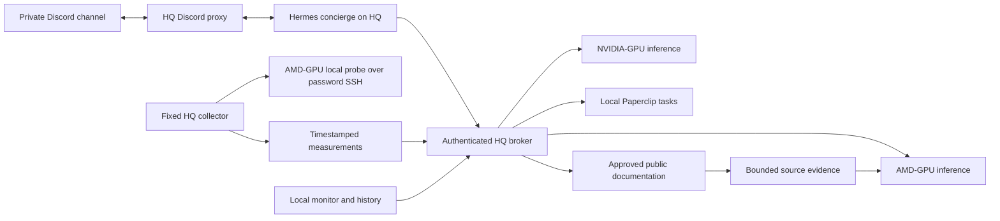

# 2. Architecture

## Systems

| System | Address | Responsibility |
|---|---|---|
| HQ gateway | `192.0.2.180` | Discord, Hermes runtimes, broker, evidence collection, Paperclip and local orchestration |
| NVIDIA-GPU VM | `192.0.2.181` | NVIDIA-GPU inference via authenticated HTTPS API; basic host observation |
| AMD-GPU | `198.51.100.202` over ZeroTier | Large-model inference; fixed local host measurements through a restricted observer |

## Compute and tool execution

Hermes v0.22.6 is pinned by revision and immutable image digest in `release.json`. The concierge and optional fast health/backup/triage runtimes run on HQ and use NVIDIA-GPU `qwen3.5:9b` at a per-request 65,536 context. Specialist health/backup/triage analysis defaults to the AMD-GPU analyst. The named team has separate fixed model assignments in [capabilities](capabilities.md). They do not run inside the GPU VM.

The AMD-GPU analyst is a direct, tool-free Ollama analysis service on HQ, using `qwen2.5:72b-instruct-q8_0` at an 8,192 context. It is not a Hermes runtime: this installed Hermes release requires a larger context than the AMD-GPU model advertises. AMD-GPU receives bounded evidence, not collection tools.

Public document fetching occurs on HQ. The generic documentation tool validates approved HTTPS origins and public DNS addresses, pins the selected address, validates TLS, refuses redirects, limits content, and records source hashes. Rachel's separate public research collector supports web search and follows a bounded number of public HTTPS source links and redirects, validating each destination. AMD-GPU receives evidence for analysis only.

## Network boundaries

Agent containers join the internal Docker network. They have no SSH keys or Docker socket. Only the broker reaches inference services and approved research destinations. Discord traffic goes through an explicit-host CONNECT proxy. The broker's operator port is published only on `127.0.0.1:18880`.

The AMD-GPU collector now uses password SSH as krishadmin, as selected by the operator, and a fixed HQ command allowlist to invoke local measurement probes. Its account is not server-side restricted; the former forced-command key is not used by this transport. NVIDIA-GPU retains the forced-command observer. This workflow does not browse from AMD-GPU and does not establish a global outbound firewall policy for unrelated software on that host.

## Evidence boundaries

Basic telemetry includes root-filesystem capacity, available RAM and load averages. It does not certify RAID, SMART, all filesystems, hypervisor state or complete application health. GPU memory residency confirms reported model memory placement; it does not establish current GPU utilization or answer quality. Database restore tests are separate from full application recovery.

See [the named team and expanded capabilities](capabilities.md) for model assignments, uploaded files, code/config review, draft artifacts, exact arithmetic, local knowledge and specialist task submission.
