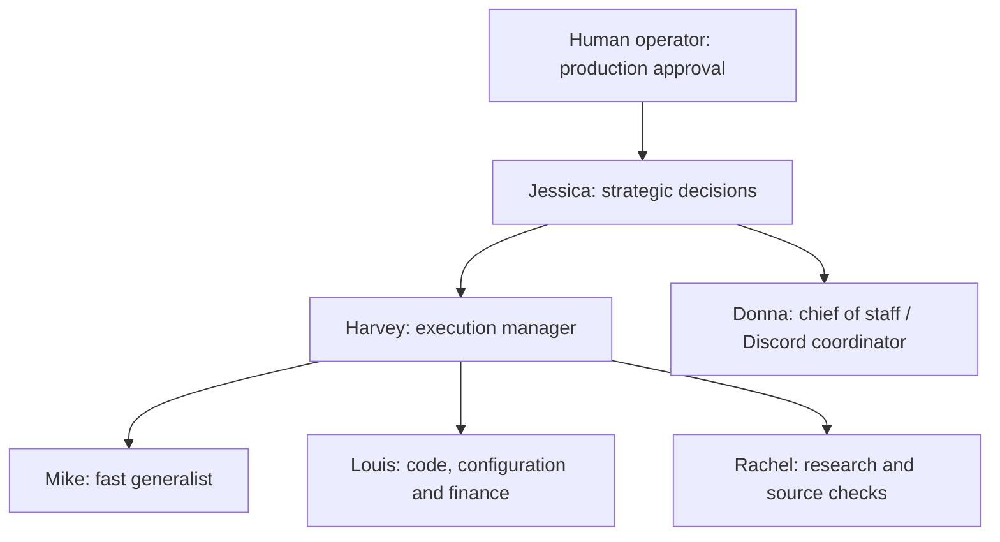

# 12. Suits team, specialist compute, and uploaded files

## The team

| Agent | Responsibility | Compute | Installed model | Reports to |
|---|---|---|---|---|
| Jessica Pearson | Managing partner / strategic lead | AMD-GPU | `mixtral:8x22b-instruct-v0.1-q4_K_M` (140.6B MoE) | Operator |
| Harvey Specter | Manager / execution planning | AMD-GPU | `gemma2:27b-instruct-q8_0` (27.2B) | Jessica |
| Mike Ross | Fast generalist / implementation assistant | NVIDIA-GPU | `qwen3.5:9b` (9.7B) | Harvey |
| Louis Litt | Code, configuration and financial-analysis specialist | AMD-GPU | `qwen2.5-coder:32b-instruct-q8_0` (32.8B) | Harvey |
| Rachel Zane | Research and source-checking specialist | NVIDIA-GPU | `qwen3.5:9b` (9.7B) | Harvey |
| Donna Paulsen | Chief of staff / front desk and knowledge coordinator | NVIDIA-GPU | `qwen3.5:9b` (9.7B) | Jessica |



Jessica uses the largest installed model by parameter count, a 140.6B mixture-of-experts model. Parameter count is not a guarantee of better answers for every task. Harvey uses a smaller general model to favor latency. Louis uses the specialized coding model even though his parameter count exceeds Harvey's; the hierarchy represents responsibility, not a strict parameter ranking.

Each named specialist has a separate service, profile, broker credential and fixed model assignment. They are tool-free local inference workers orchestrated by Hermes on HQ. Donna is also the coordinating persona of the existing Discord gateway. All collection, file parsing, calculation, draft writing and delegation run on HQ; NVIDIA-GPU and AMD-GPU perform inference. Rachel's research uses NVIDIA-GPU inference and HQ internet collection. No browsing or model-selected commands run on AMD-GPU.

The six named agents are registered in Paperclip with these reporting lines. [Paperclip Control Center](https://paperclip.example.invalid/KRI/control-center) opens on the Suits team tab and displays their models, responsibilities and live Paperclip activity states. Jessica is the top-level lead; the existing workflow coordinator now reports to Donna, preserving existing task assignments. Named task execution is on demand, one concurrent Paperclip run per agent, with a default daily run cap of 24. Workers propose decisions and drafts; the human retains production approval. The original health/backup/triage agents remain available.

## Compute routing

- Fast Discord coordination: NVIDIA-GPU Qwen3.5.
- Ordinary health, backup and triage specialist analysis: AMD-GPU Qwen2.5 72B by default. `--compute nvidia-gpu` selects the existing fast worker explicitly.
- Named delegation: uses the fixed model in the table.
- Mike: NVIDIA-GPU by default; `compute amd-gpu` escalates to the tool-free Qwen2.5 72B analyst on Mike's behalf.
- Research collection: HQ; generic research analysis uses AMD-GPU, while Rachel's named research analysis uses NVIDIA-GPU.

`python3 hq.py compute` reports actual recent relay receipts, models, identities, latency and GPU memory evidence. It is not a whole-host utilization dashboard and does not include unrelated clients. Shared GPU locks serialize this system's requests; not every other local application shares those locks. Models can be evicted/reloaded as VRAM fills, so first requests can take longer.

In one short checklist test, Jessica took 67.1 seconds on first load and 4.7 seconds warm; Harvey took 28.9 seconds on first load and 2.3 seconds warm; Louis took 33.7 seconds on first load and 2.6 seconds warm. Output lengths differed, so these are observed request timings, not a universal throughput or quality ranking. Detailed receipts are in `validation/team-benchmark-live.json` and broker audit metadata.

## Ask the team in Discord

Mention the existing bot account, then name the person:

```text
<@900000000000000001> Jessica, compare these two designs and recommend one with risks and rollback steps.
<@900000000000000001> Harvey, turn that recommendation into an implementation plan.
<@900000000000000001> Louis, review the Python file attached to this message and propose a fix.
<@900000000000000001> Mike, summarize these notes into a checklist.
<@900000000000000001> Rachel, compare the documentation at these approved URLs and cite the sources.
<@900000000000000001> Donna, find the runbook for rotating the Discord token.
<@900000000000000001> Show which models and GPUs have actually handled requests.
```

Donna delegates explicit named requests through `hq_team`. The supported Jessica-to-Rachel research workflow runs Jessica’s brief, HQ source collection, and Rachel’s analysis in sequence; there is no unrestricted recursive agent loop. For a durable tracked task, explicitly ask her to create a Paperclip task assigned to the named person.

## Files you send

Attach a file to your authorized Discord message and mention the bot. Hermes caches it on HQ. `hq_files` exposes only the upload cache, not arbitrary host paths, profile secrets or SSH keys.

| Supported material | Behavior |
|---|---|
| UTF-8 text, Markdown, code, configuration, logs, CSV/TSV | Read text slices; code is never executed |
| PDF with extractable text | Extract text, up to 100 pages and bounded output |
| DOCX | Read paragraphs and tables; no macro execution |
| XLSX | Read cell values/formula text; no formula or macro execution |
| Python, JSON, YAML, TOML | Optional fixed syntax validation; not execution or unit tests |

Limits: 5 MiB per supported upload; 100,000 extracted characters; a read returns at most 4,000 characters and a next_offset. Compressed Office documents are bounded by member count and expanded size. Parsing uses a separate service/subprocess with memory, CPU and time limits. Uploads are cached and may expire; they are not a permanent document archive.

Scanned/image-only PDFs need OCR, which is not enabled. Images, audio, video, ZIP archives, executable binaries and encrypted PDFs are not handled by this reader. Do not upload credential files. The native attachment handoff now supplies file IDs; bounded readers handle the text.

A returned slice is not a complete review of a large file. The tools disclose the source hash, reviewed range, next_offset and extraction_truncated flag. Ask for additional sections when necessary. Ordinary AMD-GPU analysis uses a 32K context and conservative 24,000-byte prompt budget. Jessica uses 64K and a 56,000-byte prompt budget; larger hq_analyze inputs route to her automatically. Harvey retains a 6,000-byte prompt budget. Oversized source slices are rejected with a request to split them.

## Coding, configuration and automation

Use Louis for review and automation drafting, Mike for quick implementation help, and Harvey/Jessica for planning and decisions. The coordinator can check syntax, obtain the specialist's analysis and save a new draft with `hq_draft`. It cannot execute uploaded scripts or deploy arbitrary infrastructure changes.

Drafts support Markdown, text, Python, shell, JSON, YAML, JavaScript, TypeScript, SQL and CSV. They are written under the concierge document cache with private permissions and a unique name; existing files are not overwritten. When you request a downloadable file, the coordinator can return the draft using its native attachment mechanism. Draft creation does not prove tests or deployment occurred. Download delivery still needs an operator-side live Discord acceptance check.

For numeric work, `hq_calculate` performs bounded decimal arithmetic on HQ without a model. It supports numbers, parentheses, +, -, *, / and integer powers up to 12, at 28-digit arithmetic precision. No functions, variables or Python eval are permitted. Donna can pass verified calculations to Louis for interpretation; spreadsheet interpretation still depends on correct inputs and assumptions.

## Local command examples

```bash
python3 hq.py team
python3 hq.py compute
python3 hq.py team --agent harvey --kind plan --question 'Plan a reversible service configuration change'
python3 hq.py team --agent louis --kind code_review --question 'Review this function' --text 'def average(xs): return sum(xs)/len(xs)'
python3 hq.py team --agent mike --compute amd-gpu --kind compare --question 'Compare these designs' --text 'Design A: centralized queue. Design B: independent queues.'
python3 hq.py files
python3 hq.py knowledge --query 'backup'
python3 hq.py calculate --expression '(1250-900)/1250*100'
python3 hq.py submit --kind code_review --agent louis --request-id louis-review-example-01 --question 'Review the supplied code and propose tests'
```

`--text-file PATH` explicitly supplies a local operator-selected text file, with size/prompt limits. In Discord, use the `doc_...` file_id returned by the upload tool; never substitute a credential path.

## Tools and skills

Eleven actual tools are registered: `hq_status`, `hq_task`, `hq_research`, `hq_analyze`, `hq_files`, `hq_knowledge`, `hq_draft`, `hq_team`, `hq_calculate`, `hq_diagnostics`, `hq_github`. Native tool search remains disabled, so the model cannot expand that surface.

Thirteen new workflow skills cover code review, automation, uploaded files, knowledge, planning, team coordination, each named character, and fixed host diagnostics. Skills are operating instructions; their capabilities come from these implemented tools and services. The existing health, task and research skills remain.

Rachel’s research now performs public web search on HQ, then fetches and follows relevant source/specification links before analysis. Public requests use HTTPS with public-address validation on every redirect; private/LAN destinations are blocked. The general `hq_research` tool now accepts public research questions and optional HTTPS sources, with AMD-GPU synthesis. Additional Proxmox, NAS, UniFi and power-control integrations still require scoped enrollment and approved operations.

## Verification

All six specialists returned real model-backed responses on their assigned GPUs. A native Hermes tool-loop test validated a Python upload, delegated its review to Louis on AMD-GPU and saved a corrected draft. PDF/DOCX/XLSX parsing and non-executing syntax checks passed fixture tests. A real named Paperclip code-review task, KRI-319, reached In Review with an evidence attachment. Rachel collected an approved Python documentation page on HQ and analyzed it on NVIDIA-GPU. Default health analysis now runs on AMD-GPU.

These tests verify the backend pipeline. A real user upload and download in the Discord client remains the final platform acceptance check; no unsolicited test message was sent to your server.

See [fixed host and SSH diagnostics](diagnostics.md) for the new on-demand checks and three Paperclip checker agents. AMD-GPU collection now uses the operator-selected password authentication; the inference workers still have no credentials or host tools.

## Current research and context update

The original short-input limits are superseded by [MCP and long-context workflows](mcp.md): general public search and direct page retrieval are enabled; ordinary synthesis/reviews default to AMD-GPU, Qwen/Louis use 32K, Jessica uses 64K, and long histories compact through AMD-GPU. Fixed workbench checkers, upload validation/review and automation planning are available as MCP tools.
