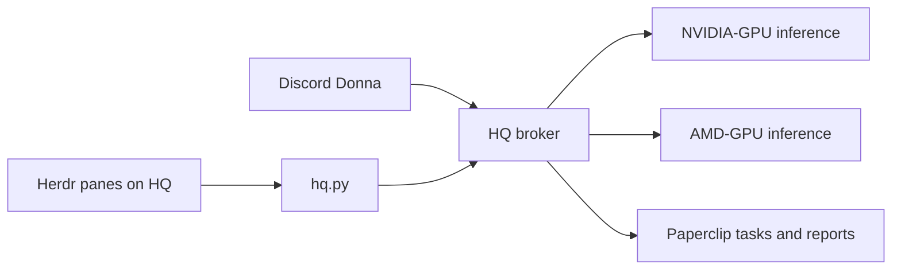

# Herdr.dev with the local Suits team

This is an integration guide, not a claim that Herdr is installed or tested on this host. No Herdr executable or user configuration was found on HQ during the November 9 review. The operator selected **herdr.dev**, the terminal orchestration project.

## Recommended arrangement

Run Herdr on HQ, where the existing tools, source checkouts and credentials already live. Use a separate pane for coordination, code review, research and task status. Each pane calls the existing `hq.py` interface; that interface loads its credential locally and sends work through the HQ broker. The broker keeps its GPU queues and residency checks. NVIDIA-GPU handles Donna/Mike/Rachel; AMD-GPU handles Jessica/Harvey/Louis and deep analysis. Herdr does not increase GPU capacity: queue contention and model reloads still apply, so start with one active job per backend.



Paperclip remains the durable task/report record; Herdr is the operator's terminal view. No inference endpoint or Herdr control socket needs public exposure. Herdr shells carry the local operator's permissions; the restricted bot policies are not a sandbox for arbitrary terminal commands. AMD-GPU remains compute-only for agent workflows.

## First setup

Install a pinned Herdr release on HQ using the [official installation guide](https://herdr.dev/tui/docs/install/), record its version, and start `herdr` from the maintained workspace. Split panes in its UI. Run these commands in the shell panes as needed (they use the existing working HQ services):

```bash
cd /home/operator/krishadmin-hq/deployments/hermes
python3 hq.py team
python3 hq.py team --agent jessica --kind plan --question 'Propose a short rollout plan for the two HQ repositories.'
python3 hq.py team --agent louis --kind code_review --question 'Review this source; do not execute it.' --text-file plugin/delivery.py
python3 hq.py research --url https://herdr.dev/tui/docs/agents/ --question 'Summarize supported agent integration and session recovery.'
python3 hq.py task-status --task KRI-360
```

For a durable task, choose a stable request ID once and reuse it on retry:

```bash
python3 hq.py submit --agent louis --kind code_review --request-id herdr-review-001 --question 'Review the Discord report delivery approach without changing production.'
```

Keep the returned task identifier and report URL. CLI submissions do not automatically enroll a Discord notification recipient. Discord-origin tasks still receive their normal follow-ups. Herdr terminal state alone is not proof that an inference or Paperclip task succeeded; inspect the returned receipt/status.

## Interactive Hermes sessions later

Herdr supports `hermes` as a recognized agent kind. Its official integration is installed with `herdr integration install hermes`; this writes a plugin into the selected Hermes home and modifies that home's config. It reports a resumable session ID, while lifecycle state uses screen detection. See [Herdr integrations](https://herdr.dev/tui/docs/integrations/#hermes-agent) and [agent automation](https://herdr.dev/tui/docs/agent-automation/).

For an interactive local-model coordinator, provision a separate Hermes profile and runtime on HQ with a dedicated broker identity and explicit tool allowlist. Then install the integration into that profile and launch it inside Herdr. The current Discord profile is containerized; a host Herdr install does not automatically configure its container or provide socket access. Do not copy the Discord bot token or reuse personal Google tokens in an interactive profile. Google Workspace requests currently require independently verified Discord DMs and cannot be moved into terminal sessions merely by adding Herdr.

Keep code changes in separate repository worktrees, inspect diffs and tests, and retain explicit confirmations for sending email/calendar changes. The initial HQ CLI pane approach avoids new model/provider plumbing and can be exercised before adding interactive-agent session restore.

## Acceptance before calling it operational

Verify the installed version and pane behavior; invoke one NVIDIA-GPU and one AMD-GPU specialist and check their real receipts; submit one intentional Paperclip task and open its returned link; test reconnect behavior without duplicating submitted work. If interactive Hermes integration is added, separately test session restoration, identity restrictions and socket mounting. These Herdr-specific checks have not yet been run.
